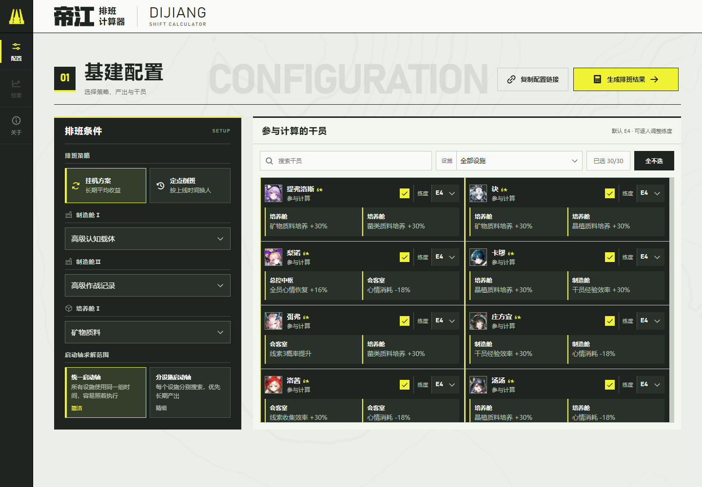
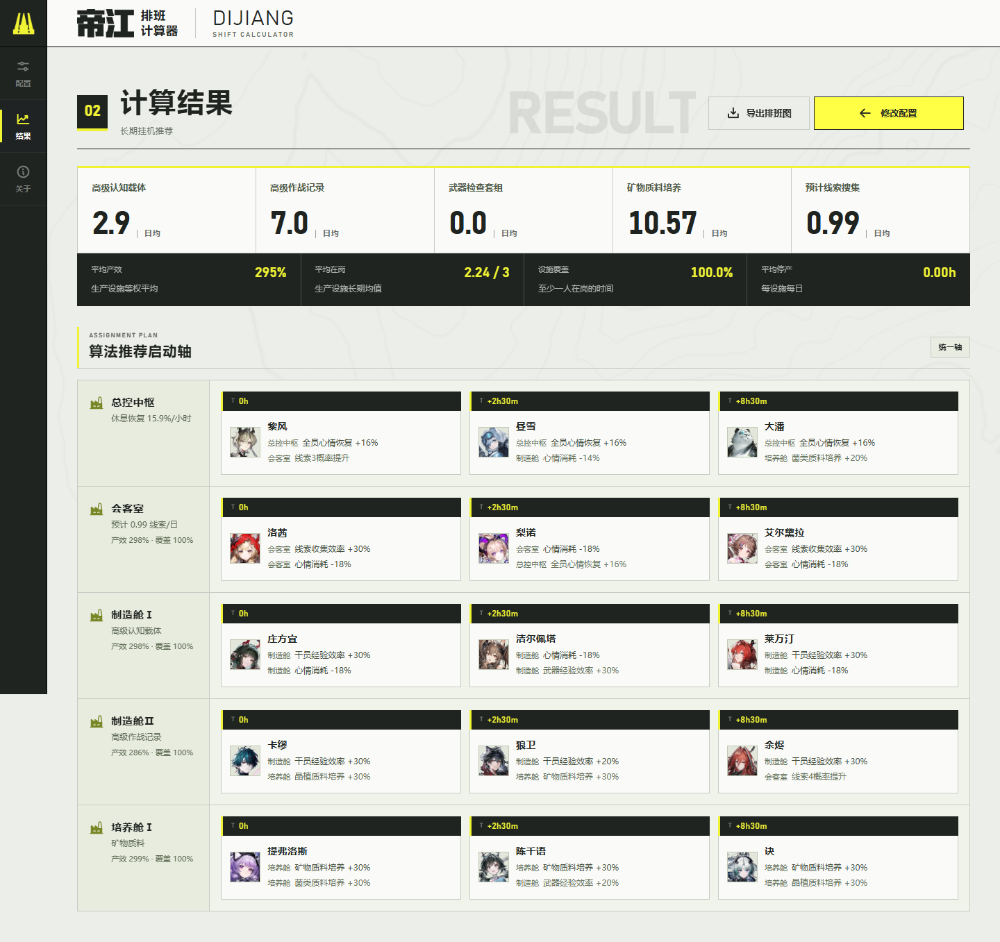

<div align="center">

# Endfield-IS

**《明日方舟：终末地》帝江号基建排班计算器**

根据干员、练度与生产配方，自动比较单班错峰、AB 双班和混合安排，也可手动指定各舱室时段。

[简体中文](README.md) · [English](README.en.md)

[](https://www.endfieldis.dpdns.org/)
[](https://endfield-is.vercel.app/)
[](https://github.com/Socialist-Sister/Endfield-IS/releases/tag/v0.3.0)
[](https://react.dev/)
[](https://vite.dev/)
[](#核心能力)

<kbd>Automatic / Manual</kbd> <kbd>Single / AB Rotation</kbd> <kbd>Morale Simulation</kbd> <kbd>Production Estimate</kbd>

</div>

---

> Endfield-IS 是一个面向帝江号基建的非官方计算工具。玩家手动填写持有干员、练度、生产目标及可选的舱室时段；项目不会读取、识别或操作游戏客户端。

## 目录

1. [在线使用](#在线使用)
2. [界面预览](#界面预览)
3. [核心能力](#核心能力)
4. [排班模式](#排班模式)
5. [计算模型](#计算模型)
6. [本地开发与测试](#本地开发与测试)
7. [部署](#部署)
8. [数据与素材](#数据与素材)

---

## 在线使用

| 站点 | 用途 | 地址 |
|---|---|---|
| EdgeOne Makers | 面向大陆网络的主部署 | [打开计算器](https://www.endfieldis.dpdns.org/) |
| Vercel | 海外与备用部署 | [打开计算器](https://endfield-is.vercel.app/) |

### 使用流程

1. 选择 **自动方案**（推荐方式、人员和时间）或 **手动方案**（指定各舱室方式与时间后配人）。
2. 设置两个制造舱的固定配方、培养材料类别，以及对应的排班参数。
3. 勾选至少 1 名已拥有干员并调整 E0–E4 练度；所有干员默认 E4，但初始均不勾选。
4. 开始计算，查看逐舱排班、启动时间、技能生效状态和预计日产量。
5. 复制当前配置链接，或将计算结果导出为带主站地址的排班图。

---

## 界面预览

<div align="center">
  
  
</div>

界面以终末地官网为主要视觉参考，使用黑、雾白与信号黄构成适合计算工具的信息层级，并适配桌面与窄屏窗口。

以上为 `v0.3.0` 实际界面：统一等高线背景、深色已选干员卡、带动效的下拉菜单，以及来自用户提供素材的“帝江”字标和游戏内图标。配置与结果两步操作流程保持一致。详见 [v0.3.0 发布说明](docs/releases/v0.3.0.md)。

---

## 核心能力

- **32 名可排班干员**：排除暂无可靠基建数据的两种管理员形态；没有匹配技能的干员仍可作为通用进驻人员参与计算。
- **练度驱动技能**：逐名设置 E0–E4，自动控制最多两个基建技能的解锁和升级。结果页同时展示两个技能槽，未解锁或不生效技能会保留并置灰。
- **逐舱生产目标**：制造舱Ⅰ、制造舱Ⅱ分别固定选择高级认知载体、高级作战记录或武器检查套组；培养舱Ⅰ固定选择矿物、晶植或菌类类别。
- **跨设施唯一分配**：统一计算总控中枢、会客室、制造舱Ⅰ、制造舱Ⅱ和培养舱Ⅰ，每名干员只编入一个预设班组，允许空班与不满编。
- **连续心情模拟**：模拟工作消耗、总控恢复、技能修正、自动下班与满心返岗；AB 接班不会重置心情，未上班的班组不提供技能。
- **真实产量目标**：以稳定周期的实际日产量优化方案，允许在收益更高时出现短暂停工，而不是把 100% 覆盖率设为硬约束。
- **非阻塞计算**：长时间搜索在 Web Worker 中运行，并用贴底进度条显示进度。
- **纯前端分享**：配置压缩到 URL 哈希中，不上传账号数据；结果页可直接生成适合社区发布的排班图。

---

## 排班模式

### 自动方案

联合推荐各舱室的单班错峰或 AB 双班、人员和时段。候选包含混合安排；不预设双班一定更优。以长期产效比较，数值持平时优先易于设置的安排。搜索为启发式，不保证全局最优。

### 手动方案

按舱室指定单班三个槽位的首次进驻偏移，或 AB 的开始时间与 A 组时长；B 组补齐全天。支持跨午夜、半小时粒度及应用到所有舱室。算法在固定约束下推荐人员。AB 时刻统一使用 UTC+8，不依赖玩家上线时间。

> **换班机制预览适配。** 暂按舱室独立设置、每人仅一个预设、空班停工以及现有疲劳离岗/满心情返岗机制计算；AB 只在当前班组时段内返岗。实际游戏规则仍需实装核验。上方 v0.3.0 截图用于展示既有视觉风格，排班模式以当前页面为准。

---

## 计算模型

| 项目 | 当前口径 |
|---|---|
| 工作心情消耗 | `7% / 小时` |
| 总控中枢恢复 | 基础 `12% / 小时`，再乘算生效的恢复技能修正 |
| 制造 / 培养 / 会客效率 | `(1 + 40% × 在岗人数) × (1 + 匹配技能总和)` |
| 通用进驻加成 | 没有匹配设施技能的干员仍提供每人 40% 加成 |
| 制造时长 | 高级认知载体 `24:26:40`；高级作战记录、武器检查套组 `09:46:40` |
| 培养对象 | 固定一个类别；按 9 箱、单箱 `61:06:40` 折算，不覆盖同类内其他耗时材料 |
| 线索基础周期 | 按 `72 小时` 估算；该常量仍待游戏内独立核验 |
| 无人在岗 | 按停产处理；不计无人生产、批次收获或手动助力 |
| 特定线索技能 | 仅保留 L1 / L2 定性倾向；同类效果不叠加，不虚构固定每日线索数 |

制造舱各自保持所选配方不变；两个舱选择相同配方时合并日产量。总控中枢以外的单班错峰设施不会混用心情消耗降低干员与普通干员，避免排班周期错位。

> 计算公式和心情循环已用独立闭式解交叉验证；这不等于所有绝对产量已获游戏实测确认。制造耗时的基础效率/每批数量、培养类别内不同耗时及线索基础周期仍有核验限制。详见 [v0.2.0 计算核验](docs/reviews/calculation-v0.2.0.md)。

---

## 本地开发与测试

需要 Node.js 20 或更高版本。

```bash
npm install
npm run dev
```

生产构建与测试：

```bash
npm run build
npm test
npm run test:sites
```

浏览器资源输出到 `dist/client`；构建脚本还会生成 Sites 交付所需的 `dist/server/index.js` 和 `dist/.openai/hosting.json`。

测试覆盖稳定周期启动轴、连续心情追踪、跨设施技能切换与唯一分配、少干员分配、固定材料类别、逐舱配方、分享复制失败处理，以及导出图的文字换行和动态布局。

使用 `npm run benchmark` 对照全员 E4 自动方案与固定 AB 手动方案的耗时和产出。候选先短窗口搜索，最终统一采用 180 日预热、90 日采样复核；旧单班统一轴推荐仍作为自动方案基线。旧版本性能记录见 [性能复核](docs/reviews/performance-2026-09-06.md)。

### 技术栈

React 19 · Vite 6 · Phosphor Icons · Web Worker · Node.js 原生测试运行器

---

## 部署

两个站点均连接本仓库的 `main` 分支并自动构建发布。

| 平台 | 安装命令 | 构建命令 | 输出目录 |
|---|---|---|---|
| EdgeOne Makers | `npm install` | `npm run build` | `dist/client` |
| Vercel | `npm install` | `npm run build` | `dist/client` |

Vercel 的路由与构建设置见 [`vercel.json`](vercel.json)。
搜索与社交分享统一以 EdgeOne 自定义域名作为 canonical 主站，Vercel 保留为备用访问入口。

---

## 数据与素材

干员头像以本地静态资源随项目发布，避免运行时依赖第三方图片服务。头像对应关系参考了 [MR-LORD-REX/endfield-builds](https://github.com/MR-LORD-REX/endfield-builds) 的公开映射。

噗切娜的基建技能与 E1–E4 解锁/升级数据核对自 [华法琳 Wiki](https://warfarin.wiki/cn/operators/purrchena)，并与 [perlica.moe](https://perlica.moe/operators/purrchena) 交叉核对；新增头像取自后者并在本地裁切为方形。核对日期：2026-09-26。

祀的会客室线索效率与心情减耗技能、E1–E4 解锁/升级数据核对自 [华法琳 Wiki](https://warfarin.wiki/cn/operators/si) 和 [perlica.moe](https://perlica.moe/operators/si)；方形头像取自后者并原样本地打包。核对日期：2026-10-15。

界面背景纹理来自终末地官网；“帝江”字标与帝江号图标来自用户提供的游戏素材，保留原图字形和轮廓，仅裁切并适配配色。来源及处理方式见 [品牌素材说明](docs/brand/README.md) 和 [背景素材说明](public/textures/README.md)。

《明日方舟：终末地》及其角色、美术与相关素材版权归 Hypergryph / GRYPHLINE 所有。本项目为非官方工具，不主张对相关游戏素材拥有权利。

欢迎通过 [Issues](https://github.com/Socialist-Sister/Endfield-IS/issues) 提交数据纠错、算法问题或界面建议。
